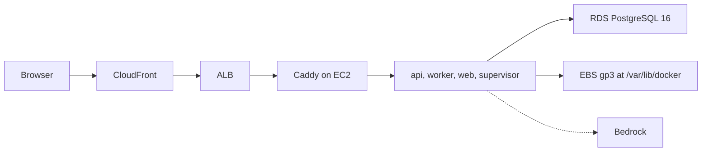

# Self-host on AWS

Terraform in [`infra/aws`](../infra/aws) runs the [published-images stack](./self-host.md#published-images-no-checkout) on one Graviton EC2 host with Amazon RDS for Postgres. EC2 is used because the sandbox supervisor needs the Docker socket to start bot computers; Fargate, Lambda and App Runner cannot provide it.



## What it creates

- VPC with two public subnets (ALB, host) and two private database subnets. No NAT gateway and no SSH port; shell access is Session Manager.
- `m7g.xlarge` Ubuntu 24.04 host. The images are multi-arch, so no special tag is needed.
- RDS PostgreSQL 16, encrypted, Multi-AZ by default. RDS keeps the master password in Secrets Manager; the host reads it at boot, so it is not in Terraform state or user data.
- Encrypted gp3 volume at `/var/lib/docker` (bot homes, uploads, images) with daily snapshots kept for 7 days.
- ALB that only accepts CloudFront traffic, and a CloudFront distribution that caches `/assets/*` and passes everything else through, including WebSocket and the live computer screen.

## Deploy

```bash
cd infra/aws
cp terraform.tfvars.example terraform.tfvars   # git-ignored; edit region, domain, zone
terraform init
terraform apply
```

The first boot takes several minutes. Follow it with `sudo tail -f /var/log/rakazo-bootstrap.log` after `aws ssm start-session --target <instance_id>`. Then open the `url` output.

Set `signup_allowlist` before applying. The site is public from the first start and the first account to register becomes the deployment owner.

## Behavior to know

- **Database overlay.** The host runs `docker-compose.images.yml` plus [`docker-compose.external-postgres.yml`](../infra/compose/docker-compose.external-postgres.yml), which points the API and worker at `EXTERNAL_DATABASE_URL` and does not start the bundled Postgres. The API applies migrations on start. The connection uses TLS with `sslmode=no-verify`: encrypted, but the RDS certificate is not verified.
- **Restricted computer egress.** The host applies [`restrict-computer-egress.sh`](./self-host.md#restricted-computer-egress) and sets `SANDBOX_COMPUTER_EGRESS=restricted`, so bot computers reach the public internet only, never the instance role or the VPC. The metadata hop limit is 2 so the API container can use the role.
- **Long streams.** CloudFront closes an origin connection after 60 seconds without data. Streams that can go quiet longer than that need keepalives.
- **Host replacement.** Terraform ignores AMI and user-data changes so a routine apply never replaces the host that owns the data volume. Replace it deliberately with `terraform apply -replace=aws_instance.app`; the data volume is reattached but the bootstrap runs again on a fresh `.env`, so keep `ENCRYPTION_KEY` safe first.
- **Source ref.** The host downloads compose files and helper scripts from `rakazo_ref` of the public repository `rakazo_repo` (default `elie222/rakazo`; set it to your fork when deploying from one), so that ref must already contain `docker-compose.external-postgres.yml` and the scripts the bootstrap uses.
- **Updates.** Pin `rakazo_image_tag` and `rakazo_ref` to a release for reproducible installs, and update them deliberately.
- **Costs.** The load balancer, Multi-AZ RDS, and the instance run continuously. Set `db_multi_az = false` for a trial.

## Amazon Bedrock

Set `bedrock_model_id` (and narrow `bedrock_resource_arns`) to give the instance role permission to invoke models and to set `PI_DEFAULT_CREDENTIALS=host`, `PI_DEFAULT_PROVIDER=amazon-bedrock`, `PI_DEFAULT_MODEL` and `AWS_REGION`. No API key is stored. Leaving it empty grants no Bedrock access; any other provider keeps working through the normal connection settings.

## Not covered

Terraform state holds the CloudFront origin secret. Keep it in a private remote backend. Scaling beyond one host (separate API and worker, dedicated sandbox nodes) is not part of this module.
